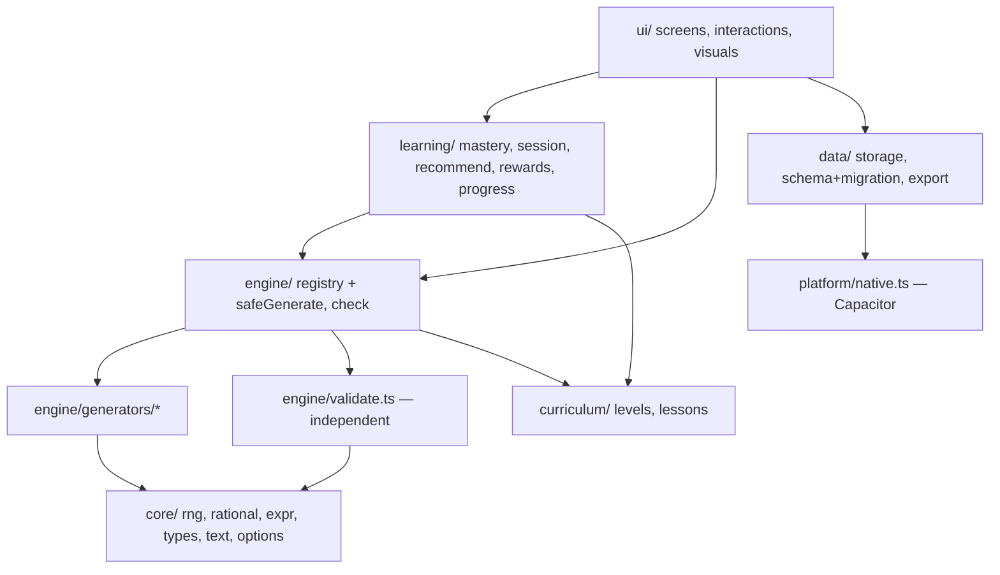

# Architecture

## Decision summary

| Decision | Choice | Why |
|---|---|---|
| Language | **TypeScript (strict)** | Typed question schema, interactions and storage; refactor safety. |
| UI framework | **None (vanilla TS + a 20-line `h()` DOM helper)** | v1.1 was vanilla JS with simple screens. React would add bundle weight and a rewrite risk without a clear benefit for this UI. The main bundle is about 116 KB gzipped, which suits budget Android phones. |
| Build | **Vite 8** | Fast builds, ES modules, PWA plugin. |
| Tests | **Vitest 5 + fast-check 4** (unit/property), **Playwright 1.65 + axe-core** (E2E/a11y) | Property-based testing for randomized generators; real-browser E2E on three viewports. |
| Offline | **vite-plugin-pwa (Workbox)** | Precaches every asset; verified offline in E2E. |
| Native | **Capacitor 8** | Wraps the same web build; offers native storage, back button, lifecycle, text-to-speech, and file share. |
| Persistence | `localStorage` (web) / **@capacitor/preferences** (native) behind a `KV` interface | Native storage is not subject to WebView eviction. A memory fallback is used in private browsing. |

## Layers

Dependencies point downward only. `core/` has no dependencies. `engine/`, `learning/` and `data/` are pure TypeScript with no DOM, so they are unit-tested in Node.

## The question pipeline

1. **Registry** (`engine/registry.ts`) maps each of the 59 skills to weighted generators. Each generator has a minimum difficulty and a mode (solve, explain, mistake, another-way, detective, story).
2. **Generator** (`engine/generators/*.ts`) receives a seeded `Rng` and a difficulty, and returns a `QuestionDraft`. The draft holds the prompt, story, visual, interaction (answer key), hints, explanation, steps, and a machine-checkable **`math` spec**. Explanation options carry **claims**: expressions the validator evaluates.
3. **`buildQuestion`** adds metadata (level, skill, objective, generator version, seed, signature) and calls **`validateQuestion`**.
4. **Validator** (`engine/validate.ts`) never trusts the answer key. It recomputes correct responses from the givens using its own shape, coin, unit-magnitude, conversion, clue and always/sometimes/never tables and exact rationals. It then compares the result with the key and also checks visuals, grammar, hint consistency, explanation consistency, story text, and representability. See [MATH_VALIDATION.md](MATH_VALIDATION.md).
5. **`safeGenerate`** returns only validated questions. It tries a weighted generator with several seeds, then other generators **of the same skill**, then throws `GeneratorUnavailable`. The activity runner skips that slot (unscored) and logs a diagnostic. **There is no cross-skill fallback** (audit finding C1).
6. **Answer checking** (`engine/check.ts`) is pure and accepts every valid answer: equivalent fractions on a number line, any valid factor-pair array, any correct story plan.

## Learning model

- `learning/mastery.ts` holds the evidence records and the six states (Not started → Learning → Practicing → Ready → Provisionally mastered → Retained), the Skill Check and check-back logic, and plain-language explanations. See [ASSESSMENT_AND_ADAPTATION.md](ASSESSMENT_AND_ADAPTATION.md).
- `learning/session.ts` plans sessions (2 guided, 4 independent, 2 reasoning). Its in-session `Adapter` steps difficulty on evidence, never on speed. It also computes the guess rate per interaction.
- `learning/progress.ts` is a pure function that applies one scored attempt to a profile. It refuses unvalidated questions.
- `learning/recommend.ts` produces explainable recommendations and suggests a placement level.
- `learning/rewards.ts` gives fixed, effort-based coins and badges, with no randomness.

## Data

- **Schema v2** (`data/schema.ts`): `AppState { schemaVersion: 2, activeProfileId, profiles{}, settings, parent, onboarded }`. Each child profile holds a nickname, mascot, level, coins, badges, practice days, totals, per-skill evidence (capped at 60 attempts), history (capped at 200), counters, and family activities.
- **Validation and repair:** untrusted JSON (saved state or a restored backup) passes through `repairState`. It clamps numbers, drops unknown skills, and repairs arrays. Unreadable data is copied to `mq2_corrupt_<timestamp>`, never destroyed.
- **v1.1 migration:** `mq_profile`, `mq_settings` and `mq_lastGrade` are migrated once. The **v1 keys are left untouched** and a copy goes to `mq2_v1_backup`. Coins, mascots, badges, totals, stars, per-topic stats, trophies and history are all preserved. Grades map to levels (K→1, 1→2, 2→3, 3→4) and topics map to skills (all 37 v1 topics are mapped and tested).
- **Saves** are debounced (250 ms) and flushed on `visibilitychange`, `pagehide`, and native `pause`.

## UI

- `ui/app.ts` provides the navigation stack with leave guards, focus management on screen change, accessible modals (focus trap, Escape, focus restore, `aria-modal`, inert background), toasts mirrored to a live region, the parental gate, break reminders, and an error boundary.
- `ui/visuals.ts` draws every mathematical model as SVG or DOM: exact equal-sector fraction circles, scaled bar-graph axes, a clock whose hour hand moves with the minutes, rulers with a start offset, and a matching-model comparison bar. Every visual carries a text alternative.
- `ui/interactions.ts` provides eight interaction components, all usable by touch, keyboard and screen reader.
- `ui/screens/*` contains the home, welcome/placement, map, lesson, activity (all session kinds plus results), stories, tools, games, collection/shop, and parent dashboard screens.

## Platform

`platform/native.ts` uses guarded dynamic imports, so the web build never loads native code. It handles:
- the Android back button (navigates within the app, exits only from home);
- pause/resume (flush save, stop speech);
- the status bar and splash screen;
- file export via Filesystem (cache) and Share.

Text-to-speech uses the native engine in the apps and Web Speech in browsers.

## Security headers

`index.html` sets a strict CSP: `default-src 'self'; script-src 'self'; connect-src 'self'; object-src 'none'; frame-src 'none'; form-action 'none'`. `style-src` allows `'unsafe-inline'` because the code sets computed widths for exact visuals. All user-provided text (nicknames) is sanitized and rendered with `textContent`.

## Test-only code

Builds with `--mode e2e` define `__E2E__ = true`, which exposes `window.__mqTest` (the current question) and an optional forced generator id. Production builds compile these branches away (`__E2E__ = false`).
