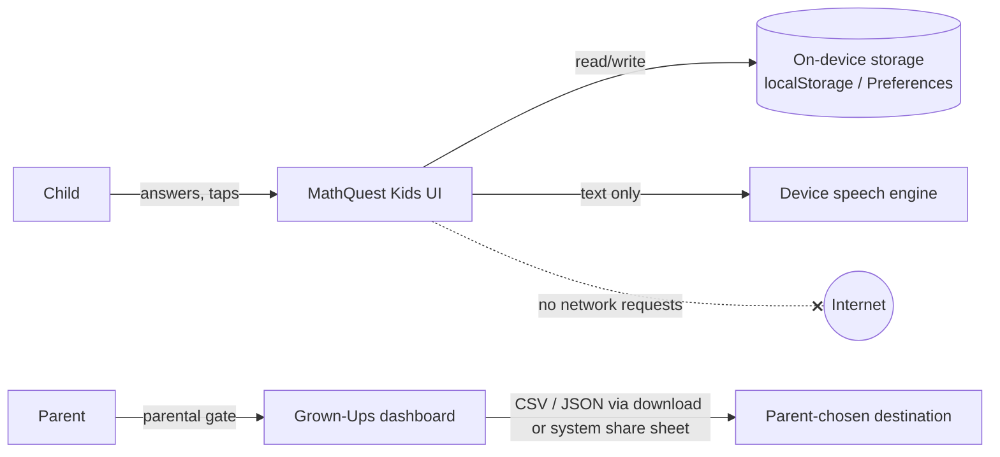

# Privacy and Data Flow

> Prepared from the actual implementation on 2026-11-06. **This is not legal advice**, and compliance has not been reviewed by a qualified professional. Regulatory references are in [research/POLICY_REFERENCES.md](research/POLICY_REFERENCES.md).

## Summary

MathQuest Kids is **local-first** and collects **no data off the device**:
- no accounts and no sign-in;
- no ads, no analytics, no crash reporting, no third-party SDKs that phone home;
- **no runtime network requests**: fonts are bundled, and the production bundle contains no `http(s)://` URLs (verified by grep);
- the CSP blocks other origins (`connect-src 'self'`), and an E2E test asserts zero requests to any other origin;
- no camera, microphone, contacts, location, advertising ID, or biometrics;
- no chat, social features, user-generated content shared with others, or generative AI.

## What is stored, where, and for how long

| Data | Purpose | Where | Retention | Deletion |
|---|---|---|---|---|
| Nickname (optional, ≤ 18 letters/digits; UI asks for a nickname, not a name) | Greeting, profile switcher | Device only | Until the profile or all data is deleted | Grown-Ups → Settings → Delete profile; Data → Erase everything |
| Mascot, coins, badges, unlocked mascots | Motivation | Device only | Same | Same |
| Level, per-skill evidence (≤ 60 recent attempts per skill: result, hints, tries, difficulty, mode, time, question signature), totals, history (≤ 200 entries; first 90 characters of the prompt) | Progress, adaptation, parent report | Device only | Rolling caps | Same |
| Practice days (dates only, ≤ 120) | "Days practiced this week" | Device only | Rolling cap | Same |
| Settings (sound, voice, text size, motion, contrast) and parent settings | Preferences | Device only | Until erased | Same |
| Copies of earlier-version data (`mq_*`, `mq2_v1_backup`) and unreadable-data copies (`mq2_corrupt_*`) | Safe migration and recovery | Device only | Until erased | Erase everything removes all `mq_*` and `mq2_*` keys (E2E-tested) |
| In-memory diagnostics (generator id, seed, issue text; **no child data**) | Troubleshooting | Memory only | Until the app closes | Automatic |

**Storage technology:**
- Web: the browser's `localStorage` for the site's origin.
- Android and iOS: Capacitor Preferences, i.e. Android SharedPreferences and iOS UserDefaults, which are private to the app.
- Android: cloud backup and device transfer of app data are **disabled** (`allowBackup=false`, `data_extraction_rules.xml`), so child data is not uploaded to Google backup. Parents can make an explicit JSON backup instead.

## Data that leaves the device (only when a grown-up does it)

| Action | What happens |
|---|---|
| Export CSV / backup (behind the parental gate) | Web: the browser downloads the file. Apps: the file is written to the app cache and the **system share sheet** opens. The parent chooses the destination; the app sends nothing itself. |
| Print report | The system print dialog opens. |
| Read aloud | Text goes to the device's **built-in** speech engine (Web Speech API or the native TTS engine). Some browsers' speech engines may use online voices, which is outside the app's control. On iOS and Android the platform engine is used. This should be checked per platform before submission. |

## Permissions

| Platform | Permissions | Notes |
|---|---|---|
| Android | `INTERNET` (Capacitor template default). **No runtime permissions.** | The app makes no network requests. Removing `INTERNET` is planned once a physical-device test confirms the WebView works without it (see ANDROID_BUILD.md). The `<queries>` entry for `TTS_SERVICE` is package visibility, not a permission. |
| iOS | None. There are no usage-description keys. | `PrivacyInfo.xcprivacy`: no tracking, no collected data. Required-reason APIs: UserDefaults (CA92.1, used by Preferences) and file timestamp (C617.1, present in the Filesystem plugin). |
| Web | None requested | The service worker caches the app's own files only. |

## Children's privacy considerations

- **COPPA (US):** no personal information is collected *from children* in the sense of being transmitted to the operator. The amended Rule's compliance date was 22 Apr 2026. A privacy policy is still needed for store listings. *Legal review pending.*
- **Apple Kids Category:** no third-party analytics or ads. External links and settings are behind a parental gate; the app has no external links. The App Privacy label should be **"Data Not Collected"**. That answer stays accurate only while nothing leaves the device.
- **Google Play Families:** the Data safety answer should be "No data collected" and "No data shared". No ads SDK. Target audience bands are a product decision.
- **UK Children's Code / GDPR:** high-privacy defaults by construction, no profiling for third parties, no nudges. Streak-loss messaging was removed, and break reminders were added.

## Parental gate

A worded 2-digit × 1-digit multiplication (beyond Level 4) plus a 1.2-second press-and-hold, with a spoken "please ask a grown-up" prompt. It guards the dashboard, exports, data deletion and parent settings. **It is a deterrent for young children, not authentication or security.**

## Third-party code shipped in the app

All dependencies are open source and none transmits data: Capacitor core and plugins (MIT), @capacitor-community/text-to-speech (MIT), workbox-window (MIT, web only), and the Baloo 2 and Nunito fonts (SIL OFL 1.1). See [ASSET_INVENTORY.md](ASSET_INVENTORY.md).

## Data flow diagram

